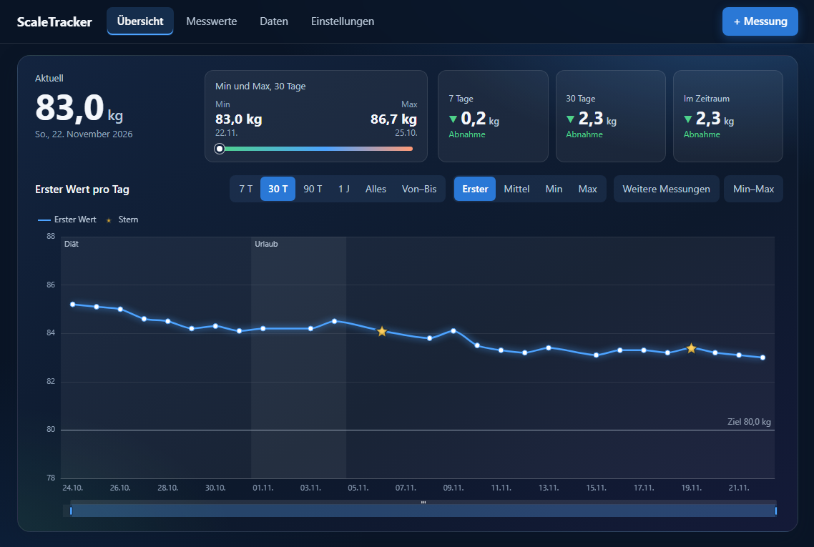

# ScaleTracker

Selbst gehostetes Gewichtstagebuch für eine Person. Deine Werte bleiben auf deinem eigenen Server und sind auf PC und Handy immer synchron.



## Funktionen

- **Messungen** mit Datum, Uhrzeit, Gewicht, Notiz, Stern und Tags
- **Graph** mit erstem Wert, Mittelwert, Minimum oder Maximum pro Tag
- **Weitere Messungen** eines Tages und **Min-Max-Band** zum Einblenden
- **Markierungen** mit Sternen und Bereichen wie „Urlaub“ direkt im Graphen
- **Auswertung** von Min, Max und Abnahme über 7 Tage, 30 Tage oder einen frei wählbaren Zeitraum
- **Zielgewicht** als Linie im Graphen
- **CSV-Import und -Export** mit deutschen und internationalen Formaten
- **HTTP-API** mit eigenen Tokens zum Senden und Abrufen von Werten
- **Login** mit Passwort, optimiert für Desktop und Smartphone

## Schnellstart

Voraussetzung sind Docker und Docker Compose.

```sh
git clone https://github.com/<dein-name>/ScaleTracker.git
cd ScaleTracker
cp .env.example .env
```

Trage in der `.env` ein eigenes `APP_PASSWORD` mit mindestens 8 Zeichen ein und starte die Anwendung:

```sh
docker compose up -d --build
```

ScaleTracker läuft danach auf `http://<server-ip>:3003`.

Beim ersten Start werden erfundene Beispieldaten angelegt. Du löschst sie unter **Daten > Demo-Daten löschen**, danach kommen sie nicht wieder. Mit `SEED_DEMO=false` startest du direkt ohne Beispieldaten.

> **Sicherheit:** Die Anwendung spricht von sich aus nur unverschlüsseltes HTTP. Gib den Port nicht direkt ins Internet frei. Nutze für den Zugriff von unterwegs ein VPN oder einen Reverse Proxy mit HTTPS.

## Konfiguration

| Variable | Standard | Bedeutung |
|---|---|---|
| `APP_PASSWORD` | keiner, Pflicht | Passwort für den Login |
| `SCALETRACKER_PORT` | `3003` | Port auf dem Server |
| `TZ` | `Europe/Berlin` | Zeitzone für die Tageswerte |
| `SEED_DEMO` | `true` | Beispieldaten beim ersten Start anlegen |
| `COOKIE_SECURE` | `false` | Hinter HTTPS auf `true` setzen |
| `TRUST_PROXY` | `false` | Hinter einem Reverse Proxy auf `true` setzen |

## Als App installieren

Hinter HTTPS lässt sich ScaleTracker in Chrome auf Android über **App installieren** auf den Startbildschirm legen. Über reines HTTP erlaubt Chrome das nicht, dort funktioniert nur eine normale Verknüpfung.

## CSV-Import

```csv
Datum;Gewicht;Notiz
11.11.2026;83,3;Normale Messung
12.11.2026;83,1;*Wichtiger Tag
12.11.-17.11.2026;;Urlaub
28.12.2026-03.01.2027;;Skiurlaub
05.02.2027;NaN;Krank
06.02.2027;NaN;Krank
07.02.2027;NaN;
```

- Ohne Uhrzeit wird 08:00 verwendet. Eine optionale Spalte `Uhrzeit` wird erkannt.
- Ein `*` am Anfang der Notiz setzt den Stern.
- Von-Bis ohne Gewicht legt einen Bereich im Graphen an, der Text wird zum Namen.
- Einzelne Tage mit `NaN`, `-` oder leerem Gewicht und gleichem Text werden zu einem Bereich zusammengefasst. Eine Lücke ergibt zwei Bereiche.
- Zeilen ohne Gewicht und ohne Text werden ignoriert.
- Doppelte Messungen und Bereiche werden nicht erneut angelegt.

## API

Einen Token erstellst du unter **Einstellungen > API-Tokens**.

```sh
# Wert speichern (ohne Uhrzeit wird 08:00 verwendet)
curl -X POST http://<server-ip>:3003/api/measurements \
  -H "Authorization: Bearer <token>" \
  -H "Content-Type: application/json" \
  -d '{"date":"2026-11-22","time":"07:30","weight":82.5,"note":"Morgens","starred":true,"tags":["Sport"]}'

# Werte abrufen
curl -H "Authorization: Bearer <token>" \
  "http://<server-ip>:3003/api/measurements?from=2026-11-01&to=2026-11-30"

# CSV importieren
curl -X POST http://<server-ip>:3003/api/import \
  -H "Authorization: Bearer <token>" \
  -H "Content-Type: text/csv" \
  --data-binary @werte.csv
```

| Methode | Pfad | Zweck |
|---|---|---|
| GET | `/api/measurements` | Messungen, Filter: `from`, `to`, `tag`, `starred` |
| POST | `/api/measurements` | Eine Messung oder eine Liste anlegen |
| GET, PATCH, DELETE | `/api/measurements/:id` | Messung lesen, ändern, löschen |
| GET | `/api/dashboard` | Tageswerte und Statistik, mit `days=30` oder `from` und `to` |
| POST | `/api/import` | CSV importieren |
| GET | `/api/export.csv` | Alle Messungen als CSV |
| GET, PUT | `/api/goal` | Zielgewicht |
| GET, POST | `/api/periods` | Bereiche im Graphen |
| DELETE | `/api/periods/:id` | Bereich löschen |
| GET | `/api/tags` | Tags |
| DELETE | `/api/tags/:id` | Tag löschen |
| GET | `/health` | Statusprüfung ohne Login |

## Backup

Die Daten liegen in einer SQLite-Datenbank unter `/data` im Container. Die Rechte dieses Ordners setzt der Container beim Start automatisch. So erstellst du im laufenden Betrieb eine Sicherung:

```sh
docker exec -u node scaletracker node --input-type=commonjs -e "const D=require('better-sqlite3');new D('/data/gewicht.db').backup('/data/backup.db').then(()=>process.exit())"
docker cp scaletracker:/data/backup.db ./scaletracker-backup.db
```

Der CSV-Export enthält nur die Messungen. Für eine vollständige Sicherung mit Bereichen, Ziel und Tokens nutze das Datenbank-Backup.

## Entwicklung

Benötigt Node.js 20 oder neuer.

```sh
npm install
npm test
APP_PASSWORD=testtest npm run dev
```

Der Stack besteht aus Node.js, Express, SQLite und Apache ECharts.
